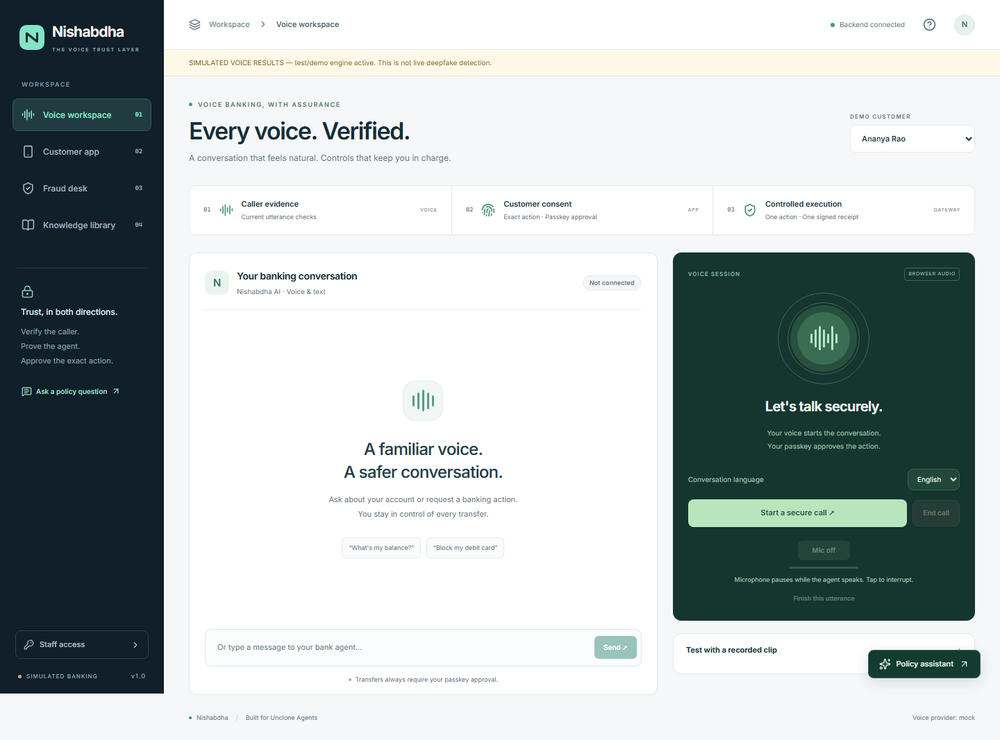

# Nishabdha — Unclone Agents

**AI voice agents that verify you, prove themselves, and act only within your permission.** Built for DetectifAI Track 3: Unclone Agents. A copied voice cannot copy your permissions.

The main experience is agent trust: current caller evidence, signed agent-session identity, bounded permissions, and verifiable decision receipts. A disclosed AI delegate may create one support ticket; it cannot read account data or move money. The existing simulated banking flow is an optional sensitive-action sandbox for exact-action approval, substitution attacks, and one-time execution. No real payment rail is connected.

Python/FastAPI, SQLite, React, browser WebSockets, DetectifAI adapters, and registered passkeys. Start in **Voice workspace**, open **Approval center** to verify the agent or authorize a delegate, and use **Trust desk** to inspect decisions.

## Run locally

Use Python 3.11. On Windows `setup.bat` installs dependencies and downloads the local voice models. Alternatively install `requirements.txt` and `requirements-dev.txt` in a virtual environment; install CPU PyTorch first as described in `requirements.txt` when using local models.

Copy `.env.example` to `.env`, set staff/audit secrets and provider credentials, then run `run.bat` or:

```powershell
python -m uvicorn app.main:app --host 127.0.0.1 --port 8000 --workers 1
```

Open **http://localhost:8000**. Use that exact origin for passkeys; `127.0.0.1` in the browser is a different origin. Set `BANK_ORIGIN` and `WEBAUTHN_RP_ID` explicitly when hosting on HTTPS. Use one process and persistent `DATA_DIR`: live sessions reside in memory; accounts, passkeys, approvals and the bank signing key reside on disk.

Configure DetectifAI from the actual API documentation supplied to your team. Adapter paths, fields, score direction and scale are configurable examples, not a verified sponsor contract. Use `scripts/check_detectifai.py` to inspect responses before enrollment. Real provider performance is not established by the deterministic security tests.

## Optional sensitive-action sandbox: transfers

1. Enter the staff key. In the Approval center choose **Set up passkey with staff**. Staff authorizes provisioning; the browser registers the customer's authenticator with user verification.
2. Enroll the genuine customer's voice with consent. Use DetectifAI for both speaker and authenticity evidence.
3. Ask to send an amount to an exact saved beneficiary, such as Amma. The agent freezes the resolved source, recipient account, integer-paise amount, session and expiry.
4. The phone displays the transaction; approve its exact details with a passkey. Voice confidence or an app token alone cannot authorize a transfer.
5. Inspect the fraud desk and signed transaction receipt. A repeated execution returns the recorded result without another debit.
6. Try a consented clone, unavailable detector, ambiguous beneficiary or copied approval. Refused or held operations leave balances unchanged.

Local anti-spoof models are diagnostic fallback and cannot authorize voice transfers when DetectifAI evidence is missing. Mocks require explicit `APP_ENV=test` or `APP_ENV=demo` and are disclosed in health/UI. Transfers accept mocks only in tests; a live transfer demonstration requires sponsor evidence.

## Two-way trust and delegated assistant

Only staff-authorized outbound sessions publish bank-call notices. The companion app verifies an expiring ES256 session proof against its trusted bank origin/key. A short code remains a session-matching aid; it does not prove the origin of arbitrary telephone speech or defeat all relay attacks.

The support-assistant demo authorizes one disclosed AI key to create one support ticket for ten minutes. A customer passkey binds the grant to the delegate key. Fresh signed requests prove key possession; revocation, expiry, replay and scope are checked server-side. The delegate cannot read balances, transfer funds or change account details. See `scripts/delegate_demo.py`.

## Security behavior

The workspace now shows caller evidence, agent identity, required permission and outcome separately. The customer app has individual delegate ticket/transfer/balance/replay/revocation controls, a visible interaction log, and owned signed decision downloads. The independent receipt verifier requires a bank key obtained separately from the trusted app and verifies locally in the browser. Held/refused requests receive durable records as well as successful actions.

See [the four-minute demonstration](docs/DEMO.md) for the presentation, isolated attack harness, memory rehearsal and sponsor integration checklist. [Decision API contracts](docs/API.md#versioned-decision-receipts) describe the additive schema and ownership boundaries.

- The LLM proposes actions. Deterministic server policy and a transaction gateway enforce permission.
- Each protected voice request uses its own utterance evidence. Historical successful chunks cannot replace timed-out checks. Typed protected requests require app approval.
- Missing evidence differs from a detected attack. Synthetic and speaker-swap flags lock voice actions and create review tickets.
- Spoken digit challenges and timing are supplementary signals; client playback telemetry cannot establish liveness.
- Transfer execution checks current restrictions, exact approval, beneficiary eligibility, per-call limits and sufficient funds inside one SQLite write transaction.
- ES256 receipts permit verification under the trusted bank key. Audit HMACs require the secret. Detecting deletion of final log entries requires a separately retained signed checkpoint. Signatures do not establish perfect detection or complete logging.
- Seeded app tokens are conveniences for a local simulated bank, not production device authentication. Transfers and delegation additionally require passkeys.

## Knowledge base

The live voice path uses reviewed extractive FAQs and abstains without evidence. It does not launch open-web research during calls. Ingestion is staff-only, destination-restricted and quarantined pending review. Lexical hashing/FTS retrieval is not a trained semantic embedding model. Citation overlap is not proof of factual correctness; no zero-hallucination guarantee is made.

## Tests and migration

```powershell
python -m pytest -q
```

The suite uses explicit test voice mocks, real audio fixtures, and a virtual WebAuthn authenticator generating real signatures. It validates application authorization, not model detection accuracy. Optional real-model tests need their separate dependencies.

The additive security migration preserves historical customers, accounts, enrollments and transactions and invalidates pending approvals from the old policy. Back up the SQLite database and signing key together. See `docs/SECURITY.md` for API changes, deployment limits and the evaluation protocol.

## Architecture and API

Read [`docs/ARCHITECTURE.md`](docs/ARCHITECTURE.md) for the complete component map, voice evidence flow, immutable transfer and passkey flow, signed bank identity, bounded AI delegate, knowledge review, failure behavior, and demo sequence. See [`docs/API.md`](docs/API.md) for frontend routes and message contracts, and [`docs/VALIDATION.md`](docs/VALIDATION.md) for checks that were actually run and remaining live-provider validation.

## Frontend development



Local demo interface with simulated voice results visibly disclosed. [Policy assistant preview](docs/images/policy-assistant.png).

The production UI is included under `app/static/ui/` and served at `/` by FastAPI. It uses React/Vite, local shadcn/ui-style Radix components, Tailwind v4, and a lazy-loaded headless CopilotKit policy assistant. The assistant streams reviewed excerpts from `/api/copilot/policy`; it has no account access or banking tools.

```powershell
npm ci --prefix frontend
npm run build --prefix frontend
```

Rebuild after changing frontend source. For browser checks, install Chromium with `cd frontend; npx playwright install chromium`, then run `npm run test:e2e`. Playwright starts its own isolated demo backend on port 8010 using `.venv`. See [`docs/FRONTEND.md`](docs/FRONTEND.md) for component ownership, design decisions, development-origin settings, and repository/license references.
